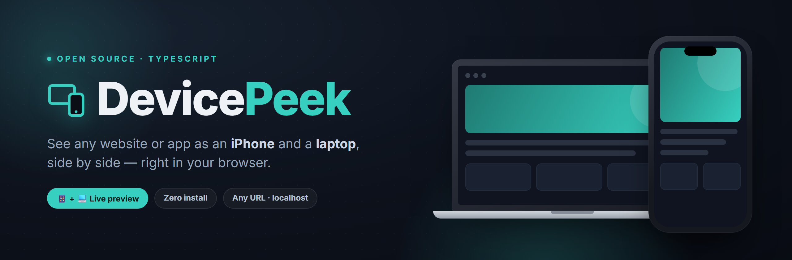
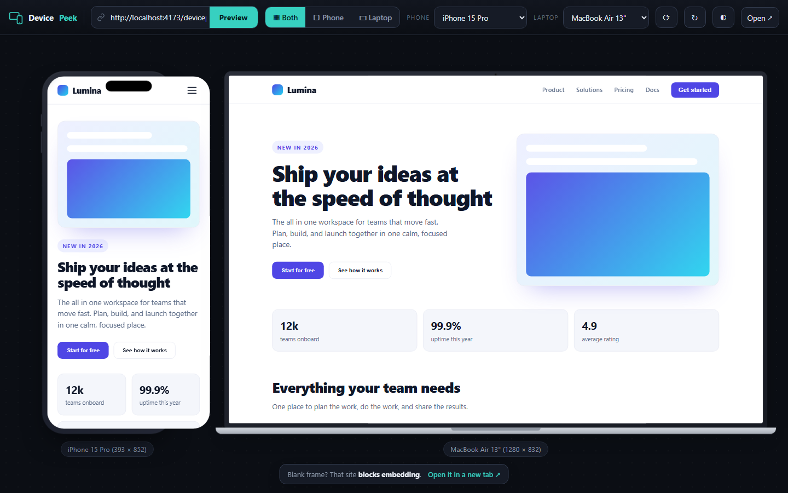

# DevicePeek

See any website or app as an iPhone and a laptop, side by side, right in your browser.

DevicePeek renders a URL at real device widths inside an iPhone frame and a laptop
frame at the same time. Paste your site, a Vercel or Netlify preview link, or
`localhost:3000`, and instantly see how the responsive layout behaves on each. It
gives you a fast feedback loop while you build an app or website.

Add DevicePeek to a project and you skip the pasting entirely. That project registers
itself when its dev server starts, so it is simply there in the Projects list, ready to
look at. See [Add DevicePeek to a project](#add-devicepeek-to-a-project).

Live app: https://fredler21.github.io/devicepeek/

## Screenshot

## Features

- iPhone and laptop, together, so you can spot responsive breakpoints at a glance
- Projects that add DevicePeek show up on their own. Add the plugin once and every dev server you start lands in the Projects list, live, with no URL to type
- Any URL, including your deploys, preview links, or `localhost` for live local dev
- Shareable preview links. Add `?url=example.com` to the address and DevicePeek opens with that site already loaded
- Device presets: iPhone 15 Pro, Pro Max, and SE, Pixel 8, Galaxy S23, plus MacBook Air, 1366, 1440, and 1024 laptops
- Rotate, reload, open in a new tab, and a light or dark backdrop toggle
- Issue detection. Load failures show up automatically, and an opt in agent snippet reports JavaScript errors, broken images, and layout overflow live, labeled per device
- True responsive rendering. Each frame is a real iframe at that device's CSS width, so media queries fire exactly as they do on the device
- Built with TypeScript and Vite, so it stays typed and tiny

## Controls

- URL bar: type any address and press Preview or Enter. It adds `https` for you, and uses `http` for `localhost` and IP addresses
- Both, Phone, Laptop: choose which frames to show
- Phone and Laptop menus: pick a device preset
- Rotate: switch the phone between portrait and landscape
- Reload: refresh both frames at once
- Backdrop: toggle a light or dark stage behind the devices
- Open in a new tab: open the current URL directly, which is handy when a site blocks embedding
- Projects: open the list of projects that registered themselves. Click one to preview it, or click the × to drop it from the list
- Issues: open the panel that shows each frame's load status and any problems detected

## Finding issues

DevicePeek can surface problems with the site you are previewing. It works in two layers.

Always on, for any URL, with no setup: each device shows a status of Loading, Loaded,
or No response, so a blank frame, a site that is down, or one that blocks embedding is
obvious right away.

Deep checks, opt in: browsers do not let one page read inside another site's frame, so
to catch JavaScript errors, unhandled promise rejections, broken images, and horizontal
overflow, your site sends them to DevicePeek. Projects using the Vite plugin already have
the agent injected into their dev HTML, so this works with no setup. For anything else,
open the Issues panel, copy the small agent snippet, and paste it into your dev build
once. It reports problems over postMessage, and DevicePeek lists them live, labeled by
device. The agent stays silent unless the page is actually inside a frame, so it is inert
if it ever reaches production.

## Tech stack

- Language: TypeScript in strict mode for the app, plain ESM for the plugin and CLI
- Build tool: Vite
- Runtime dependencies: none. The app is just DOM and CSS, and the CLI is Node built ins only
- Hosting: GitHub Pages through GitHub Actions, with the dashboard also runnable locally

## Getting started

    git clone https://github.com/Fredler21/devicepeek.git
    cd devicepeek
    npm install
    npm run dev

The dev server runs at http://localhost:5173/

Build and preview the production bundle:

    npm run build     # type checks with tsc, then bundles with Vite into dist
    npm run preview   # serve the built dist folder locally
    npm start         # serve the built app plus the local Projects API

`npm install` builds `dist` for you, so `npm start` and `npx devicepeek` work straight
after a clone.

## Add DevicePeek to a project

Adding DevicePeek to a project is what makes that project viewable in DevicePeek without
anyone typing a URL or registering a domain.

Install it in the project you are building:

    npm install -D devicepeek

Add the plugin to that project's Vite config:

    import devicepeek from "devicepeek/vite";

    export default {
      plugins: [devicepeek()],
    };

Open the DevicePeek dashboard, which you can leave sitting in a tab:

    npx devicepeek

Now start the project's dev server the way you always do. It appears in the Projects
list the moment the server is up, labeled with its package name and the port it actually
landed on, and the first live project opens in the frames by itself. Add the plugin to a
second project and it joins the list too, so you can flip between them from the sidebar
instead of the URL bar.

The plugin is dev only. It does nothing in a production build, and it also injects the
diagnostics agent for you, so the Issues panel does the deep checks with no extra setup.

Stopping a dev server removes its project from the list. If it is killed with no chance
to clean up, the row stays and turns offline, because the dashboard checks the port
instead of trusting the file.

Options, if you need them:

    devicepeek({
      name: "storefront",              // label, default the package.json name
      url: "https://tunnel.example",   // register this address instead of the detected one
      agent: false,                    // skip the diagnostics agent
    })

### Projects that are not on Vite

Any stack works. It just registers once by hand rather than automatically:

    npx devicepeek register --url http://localhost:3000 --name my-app
    npx devicepeek list
    npx devicepeek forget my-app

To get the deep checks there too, pull the agent from the running dashboard in your dev
HTML:

    

### How discovery works

A project writes its name, its dev server URL, and its folder into a small registry file
at `~/.devicepeek/projects.json`. The dashboard reads that file and lists what it finds,
probing each port to decide what is live. Nothing leaves your machine, there is no
account, and there is no server in the middle. Point `DEVICEPEEK_HOME` somewhere else to
move the registry.

The dashboard's local API binds to the loopback address only, rejects requests aimed at
any other hostname, and allows only localhost origins plus the hosted DevicePeek build.

The hosted build can read that same list, because it looks for the CLI on port 7331.
Chrome, Edge, and Firefox allow a secure page to reach localhost. Safari does not, so on
Safari use `npx devicepeek`, which serves the app from the same origin as the API.

## Project structure

    devicepeek/
      index.html                     Vite entry, markup only
      src/
        main.ts                      typed app logic for devices, layout, and scaling
        projects.ts                  polls the registry and renders the Projects list
        dom.ts                       shared element lookup helper
        style.css                    styles
        vite-env.d.ts                Vite client types
      plugin/
        vite.mjs                     the plugin a project adds to register itself
        registry.mjs                 reads and writes ~/.devicepeek/projects.json
        agent.js                     diagnostics agent, shared by the plugin, CLI, and app
        index.mjs                    Node API for stacks that are not Vite
      bin/devicepeek.mjs             CLI: the dashboard, plus list, register, and forget
      public/favicon.svg             copied to the build as is
      vite.config.ts                 base path for GitHub Pages
      .github/workflows/deploy.yml   build and deploy to Pages on every push to main

## Deployment

Deploy on Vercel:

1. Push this repo to GitHub.
2. In Vercel, choose Add New Project and import the repository.
3. Vercel detects Vite automatically. Build command is `npm run build` and the output
   directory is `dist` (also set in `vercel.json`). Click Deploy.

The Vite base path is `/` everywhere except GitHub Pages, so the Vercel build serves
correctly from the domain root with no extra config.

Deploy on GitHub Pages:

Every push to main triggers the Deploy to GitHub Pages workflow, which runs `npm ci`
and `npm run build` with the base path set to `/devicepeek/`, then publishes the dist
folder to Pages. There are no manual steps.

## How it works

1. An iframe gets its own viewport, so sizing it to 393px makes the embedded page
   render its mobile CSS. You get real responsive behavior instead of a zoom.
2. The phone and laptop frames are pure HTML and CSS drawn around each iframe.
3. Each frame is scaled with a CSS transform to fit your screen.

## Good to know

Browsers will not let a page be embedded if it sends an `X-Frame-Options` header or a
`Content-Security-Policy: frame-ancestors` header. DevicePeek works with sites that
allow embedding, such as your own apps, most preview deployments, and `localhost`. It
cannot embed locked down sites like Google, YouTube, or many banks. When a frame comes
up blank, use the Open in a new tab shortcut.

It renders with your desktop browser engine, so it is accurate for layout and
responsive breakpoints. It will not reproduce Safari quirks that happen only on iOS,
so a real device is still the final check for those.

## Contributing

Contributions are welcome. See CONTRIBUTING.md for how to set up the project and open
a pull request.

## License

MIT, by Fredler Gracia Pierre-Louis. See the LICENSE file.
